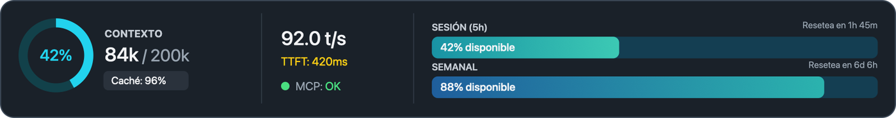
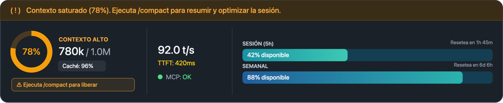

# Telemetría

Un panel para **Claude Code** que se coloca encima del cuadro de texto y te muestra de un vistazo cómo va tu sesión: cuánto contexto llevas, cómo responde el modelo y cuánto te queda de tus límites de uso.



Cuando el contexto pasa del 75 %, el panel se pone en **modo alerta** y te propone compactar la conversación:



*Las capturas usan datos inventados.*

## Instalación

Necesitas Claude Code con soporte de mods (hooks de funciones).

**Desde la terminal de Claude Code**, en el prompt:

```
/plugin install telemetria --marketplace Chamete/telemetria
```

Responde `y` para añadir el marketplace y elige el ámbito (el de usuario lo activa en todos tus proyectos).

**Desde una terminal normal:**

```bash
claude plugin install telemetria --marketplace Chamete/telemetria
```

**En la app de escritorio**, donde `/plugin` no está disponible: pulsa **+** junto a la caja del prompt → **Plugins** → **Add marketplace** con `Chamete/telemetria` → **Add plugin**.

El panel aparece solo en la siguiente sesión. No necesita configuración.

## Qué muestra

El panel tiene tres columnas:

| Columna | Dato | Qué significa |
|---|---|---|
| **Contexto** | Dónut y `84k / 200k` | Tokens que ocupa ahora la conversación frente al tamaño de la ventana de contexto del modelo |
| | Caché | Porcentaje de la entrada de la última respuesta que se sirvió desde la caché de prompts |
| **Inferencia** | `t/s` | Tokens generados por segundo en la última respuesta |
| | TTFT | Tiempo hasta que llegó el primer dato de la respuesta |
| | MCP | Resultado de la última herramienta MCP usada: OK, error o «sin uso» |
| **Límites** | Sesión (5h) | Lo que te queda del límite de 5 horas de tu cuenta, con la cuenta atrás hasta el reinicio |
| | Semanal | Lo que te queda del límite de 7 días, con su cuenta atrás |

Las dos barras de límites son **decrecientes**: empiezan llenas y se vacían con el uso, y muestran el porcentaje **disponible**.

### Modo alerta

Si el contexto supera el **75 %** (más de 750k en una ventana de 1M):

- arriba del panel aparece el aviso *«Contexto saturado (78%). Ejecuta /compact para resumir y optimizar la sesión.»*;
- el dónut y el porcentaje pasan de cian a ámbar, y el título a **CONTEXTO ALTO**;
- debajo del panel aparece el botón **Escribir /compact en el prompt**.

El botón escribe `/compact` en el cuadro de texto, pero **no lo ejecuta**: compactar resume toda la conversación y no se puede deshacer, así que lo confirmas tú con Enter. Si ya tienes algo escrito, no lo borra y te avisa.

### Se adapta al ancho

- **Ancho** (unas 70 columnas o más, lo habitual en la app de escritorio): las tres columnas en una fila.
- **Medio:** contexto e inferencia arriba y las barras debajo, a todo el ancho.
- **Estrecho:** todo apilado.

En la app de escritorio el panel es un gráfico que ocupa el mismo ancho que el cuadro de texto. En la terminal, VS Code y el móvil se muestra como una línea de texto con colores y barras `▰▱`.

## Privacidad

- El mod **no se conecta a ningún sitio** ni envía datos. Solo lee lo que Claude Code ya tiene de tu sesión: el uso de contexto, los límites que informa tu cuenta y los tiempos de cada respuesta.
- No guarda nada en disco: los valores viven en la memoria de la sesión.
- Nunca bloquea ni modifica las herramientas que usa Claude: si algo del mod falla, todo sigue igual.

## Limitaciones

- Los límites de 5 horas y semanal solo aparecen si usas Claude con una **suscripción**; con clave de API no existen.
- `t/s`, TTFT y caché aparecen después de la primera respuesta de la sesión, y solo miden la conversación principal (no los subagentes).
- El estado MCP refleja la **última llamada** a una herramienta MCP: Claude Code no permite consultar si los servidores están conectados.
- No hay contador de tokens semanales: Claude Code solo informa del porcentaje usado.
- La API de mods de Claude Code está en acceso anticipado y puede cambiar entre versiones.

## Cómo funciona

Más detalle en [docs/como-funciona.md](docs/como-funciona.md).

## Desarrollo

```
.claude-plugin/plugin.json        manifiesto del mod
.claude-plugin/marketplace.json   este repositorio como marketplace
hooks/hooks.json                  módulo de hooks que carga Claude Code
hooks/register.tsx                datos, dibujo del panel y botón de /compact
types/index.d.ts                  contrato de estado del mod
tests/telemetria.test.tsx         pruebas
```

Para trabajar en él, carga la carpeta en una sesión (se recarga sola al guardar):

```bash
claude --plugin-dir .
```

Comprobaciones:

```bash
claude plugin validate .
```

```bash
claude plugin test .
```

## Autor

Hecho por [Chamete](https://github.com/Chamete) con Claude Code.

## Licencia

[MIT](LICENSE).
